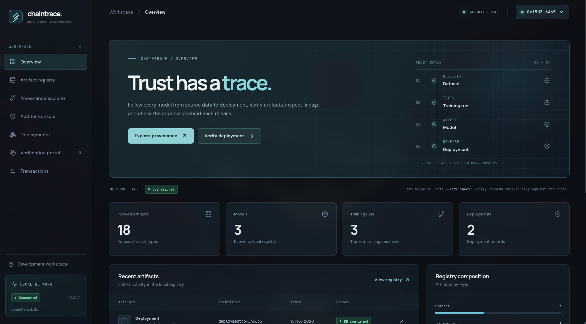
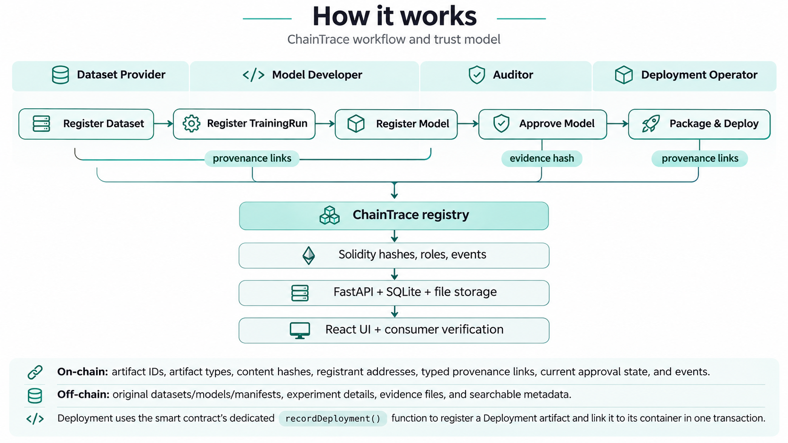

# ChainTrace

**Blockchain-backed ML artifact provenance, approval, and deployment verification**

ChainTrace is a semester-project prototype for recording and verifying the declared lifecycle of machine-learning artifacts across multiple organizations. It combines SHA-256 content hashing, role-controlled Solidity contracts, off-chain artifact storage, auditor attestations, and a web interface for exploring provenance and checking deployment trust.

The prototype uses a **phishing-website detection model** to demonstrate why an enterprise might want to verify a model's recorded origin and approval before adopting it. The ML experiment is real; the organizations, auditor attestations, and container/deployment demonstrations are simulated for local testing.

> **Scope of trust:** ChainTrace verifies that files match recorded hashes and that relationships/approvals were submitted by authorized blockchain accounts. It does **not** independently prove that a particular training run consumed its declared dataset, that a model is safe or effective in production, or that a service is currently running.



## Features

- Register five artifact types: **Dataset**, **TrainingRun**, **Model**, **ContainerImage**, and **Deployment**.
- Compute SHA-256 content hashes and keep large files off-chain.
- Record provenance: `Dataset → TrainingRun → Model → ContainerImage → Deployment`.
- Enforce role-based authorization in Solidity for providers, developers, auditors, and deployment operators.
- Allow auditors to approve and revoke model versions with a hash of supporting evidence.
- Verify individual file integrity, full model lineage, and a deployment's current trust status.
- Explore artifacts and provenance through a React dashboard.
- Authorize write transactions through **MetaMask** on a local Hardhat chain.
- Snapshot/replay local **application state** across Hardhat restarts for development.
- Track a real phishing-classification experiment using **scikit-learn + MLflow (SQLite)**.

## Technology stack

| Layer            | Technologies                                                              |
| ---------------- | ------------------------------------------------------------------------- |
| Frontend         | React, TypeScript, Vite, React Flow, ethers.js                            |
| Backend          | Python, FastAPI, Web3.py, SQLAlchemy                                      |
| Smart contracts  | Solidity, Hardhat, OpenZeppelin-style access control                      |
| Storage          | Local artifact files and SQLite                                           |
| Wallet/network   | MetaMask, Hardhat Local (chain ID `31337`)                                |
| ML demonstration | UCI Phishing Websites dataset, scikit-learn Random Forest, joblib, MLflow |

## How it works



**On-chain:** artifact IDs, artifact types, content hashes, registrant addresses, typed provenance links, current approval state, and events. **Off-chain:** original datasets/models/manifests, experiment details, evidence files, and searchable metadata.

The deployment operation uses the smart contract's dedicated `recordDeployment()` function to register a Deployment artifact and link it to its container in one transaction.

## Getting started (local development)

**Prerequisites:** Node.js/npm, Python, a browser with MetaMask, and the project's dependencies. Use a Python version supported by the installed requirements; the project was developed with Python 3.14, so pinned versions are advisable for reproducibility.

1. **Install blockchain dependencies** (from the repository root):

    ```bash
    cd blockchain
    npm install
    npx hardhat compile
    ```

2. **Install backend dependencies** (from the repository root, in a separate terminal):

    ```bash
    python -m venv .venv
    source .venv/bin/activate
    pip install -r backend/requirements.txt
    ```

    If training the demonstrator model too, install `backend/ml_demo/requirements.txt` if present, or the optional packages `pandas scikit-learn joblib ucimlrepo mlflow`.

3. **Configure the backend.** Create `backend/.env` using your local RPC URL, deployed contract address, and the settings expected by `backend/app/config.py`. Never commit actual `.env` files or credentials. Set the contract address after deployment.

4. **Start the development blockchain** (terminal 1):

    ```bash
    cd blockchain
    npx hardhat node
    ```

5. **Deploy the contract** (terminal 2, from `blockchain/`):

    ```bash
    npx hardhat ignition deploy ignition/modules/ChainTraceRegistry.ts --network localhost
    ```

    This is the deployment command used in development; confirm the filename against your local `blockchain/scripts/` directory. Update `backend/.env` with the printed address. A new Hardhat node is a new state, even when the deployed address repeats.

6. **Assign local roles or restore saved state** (terminal 3):

    ```bash
    cd backend
    source ../.venv/bin/activate
    python -m scripts.grant_local_roles
    ```

    If a compatible snapshot and local database/files already exist, use the **recovery** sequence described below instead of recreating registrations manually.

7. **Start FastAPI** (terminal 3):

    ```bash
    uvicorn app.main:app --reload --port 8000
    ```

    API documentation: `http://127.0.0.1:8000/docs`

8. **Start the frontend** (terminal 4):

    ```bash
    cd frontend
    npm install
    npm run dev
    ```

    Open `http://127.0.0.1:5173`. Vite proxies local API requests to FastAPI.

9. **Configure MetaMask** with RPC `http://127.0.0.1:8545`, chain ID `31337`, and symbol `ETH`. Import **Hardhat test accounts only**, then select the account for the operation. Never use these public development keys with real funds.

## Demo roles

| Hardhat account index | Role                   | Example permitted action                                   |
| --------------------- | ---------------------- | ---------------------------------------------------------- |
| 0                     | Contract administrator | Grant roles                                                |
| 1                     | Dataset Provider       | Register datasets                                          |
| 2                     | Model Developer        | Register training/model artifacts; create training lineage |
| 3                     | Auditor                | Approve/revoke models                                      |
| 4                     | Deployment Operator    | Register containers, package models, record deployments    |

Role assignments are enforced **by the smart contract**, not by a frontend-selected label. Switch MetaMask's active account to change the signing identity.

## ML demonstration

The project trains a Random Forest classifier on **UCI Phishing Websites (dataset 327)** using 30 pre-extracted website features. The training script produces:

```text
backend/ml_demo/outputs/
├── phishing_dataset.csv
├── training_run_manifest.json
└── phishing_model.joblib
```

The training manifest records SHA-256 digests for the actual dataset and model, MLflow run ID, algorithm, hyperparameters, metrics, and a confusion matrix. The model is intended for demonstrative validation, **not production phishing filtering**. It does not accept arbitrary raw URLs without separate feature extraction.

```bash
cd backend/ml_demo
python train_phishing.py
```

MLflow tracking was configured to use a lightweight SQLite backend (`mlflow.db`) on the development machine. **The MLflow web UI is optional** and is not required to register or verify artifacts.

The repository may contain both a **metadata-only integration-test chain** and a separate **real ML chain**. Do not describe the metadata-only container/deployment manifests as genuine running model services.

## Key API routes

| Method | Route                                                    | Purpose                                 |
| ------ | -------------------------------------------------------- | --------------------------------------- |
| `POST` | `/api/v1/artifacts/upload`                               | Store file and metadata                 |
| `GET`  | `/api/v1/artifacts/{id}/verify`                          | Compare local and on-chain hashes       |
| `GET`  | `/api/v1/artifacts/{model_id}/provenance`                | Verify model lineage                    |
| `GET`  | `/api/v1/ui/artifacts`                                   | List indexed artifacts                  |
| `GET`  | `/api/v1/blockchain/status`                              | Inspect blockchain connection           |
| `POST` | `/api/v1/blockchain/artifacts/{id}/prepare-registration` | Build unsigned registration transaction |
| `POST` | `/api/v1/blockchain/artifacts/{id}/confirm-registration` | Validate mined registration event       |
| `POST` | `/api/v1/blockchain/provenance/prepare-training-link`    | Prepare Dataset → TrainingRun link      |
| `POST` | `/api/v1/blockchain/provenance/prepare-model-link`       | Prepare TrainingRun → Model link        |
| `GET`  | `/api/v1/blockchain/audit/models/{id}/status`            | Read current model approval             |
| `POST` | `/api/v1/blockchain/deployments/prepare`                 | Prepare atomic deployment recording     |
| `GET`  | `/api/v1/consumer/deployments/{id}/verify`               | Check deployment trust policy           |

All write flows have corresponding confirmation routes. See the FastAPI Swagger page for full request/response schemas.

## Hardhat restart recovery

A standard Hardhat local node **does not retain its state across process restarts**. The project includes a development-only replay utility:

```bash
# Before stopping Hardhat, from backend/
python -m scripts.dev_chain_state snapshot

# After restarting Hardhat and redeploying the same contract,
# from backend/, before starting FastAPI
python -m scripts.dev_chain_state restore
```

The snapshot manifest, SQLite database, and original stored artifact files must be retained together. Restoring reconstructs registrations, links, roles, and currently active approvals, but **does not restore original blocks, transaction hashes, event history, or historical approval/revocation sequences**. A matching chain ID and contract address alone do not prove that the old chain state is present. Use this tool only with a trusted local Hardhat development network.

## Verification and limitations

A typical consumer verification response distinguishes:

- `lineage_complete`: whether the required declared relationships exist.
- `provenance_integrity_verified`: whether the discovered records/files/links pass integrity checks.
- `approval_active_now`: the current model approval state.
- `trusted_for_current_policy`: the result under this prototype's verification policy.

**Limitations:**

- Hash verification is **integrity evidence**, not proof that training claims are true.
- An on-chain auditor approval is an **attestation**, not independent proof of safety, robustness, fairness, or regulatory compliance.
- The demonstration uses public benchmark data and simulated organizational accounts; it does not integrate with a live phishing-intelligence feed.
- The sample container/deployment manifests do not mean real Docker images or serving infrastructure exist.
- Local SQLite and Hardhat are development infrastructure, not a production multi-organization deployment.

## Further documentation

- [`docs/ARCHITECTURE.md`](docs/ARCHITECTURE.md) — system components, data model, trust boundaries, and workflow.
- [`docs/DEMO_GUIDE.md`](docs/DEMO_GUIDE.md) — reproducible demonstration and expected outcomes.
- [`docs/API_REFERENCE.md`](docs/API_REFERENCE.md) — endpoint groups and transaction patterns.

## Security note

Do not commit `.env` secrets, wallet recovery phrases/private keys, transient node state, database files containing sensitive data, or uploaded private artifacts. The Hardhat default accounts are publicly known and **must never receive real funds**.
