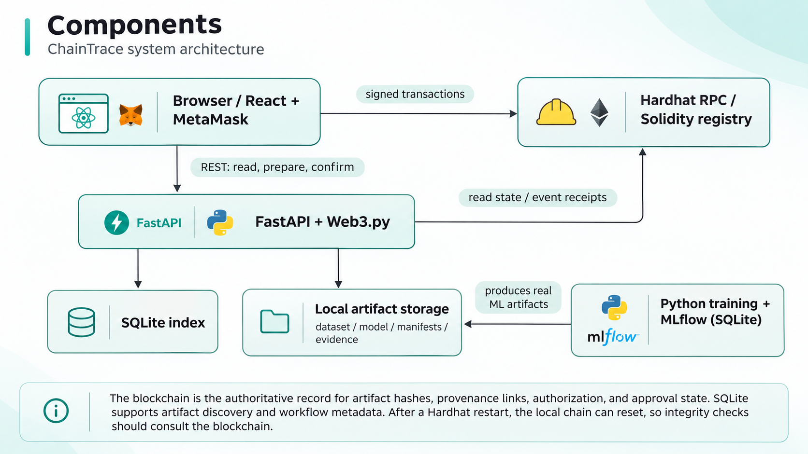

# ChainTrace architecture

## Goal

Allow independent actors to inspect the **declared chain of custody** of ML artifacts, compare their bytes with registered SHA-256 hashes, and check whether an authorized auditor currently approves a model version.

## Components



The application uses the blockchain as the authoritative record for artifact hashes, provenance links, authorization, and approval state. SQLite supports artifact discovery and workflow metadata. A database `chain_registered` flag can become stale after a Hardhat restart, so current integrity checks must consult the chain.

## Artifact identities

- **Human-readable ID**, e.g. `model:<uuid>`: generated by the backend for local records and API URLs.
- **bytes32 artifact ID**: `keccak256` of the human-readable ID for Solidity calls.
- **Content hash**: SHA-256 of the exact off-chain file bytes, represented as `0x` + 64 hexadecimal characters.

These are distinct: the artifact ID is an identifier, while the content hash verifies bytes.

## Provenance lifecycle

```text
Dataset --UsedForTraining (0)--> TrainingRun --Produced (1)--> Model
Model   --PackagedAs      (2)--> ContainerImage
ContainerImage --DeployedAs (3)--> Deployment
```

Role-limited transactions establish relationships. The contract checks artifact existence, types, duplicate links, and appropriate prior lineage. A TrainingRun needs a dataset link before producing a Model. Approval requires model provenance and an auditor different from the model registrar. Packaging requires active model approval. Deployment is registered through `recordDeployment()` rather than generic `registerArtifact()`; it records the Deployment artifact and link atomically.

## Multi-organization model

The local Hardhat accounts simulate distinct organizations, not independently verified real-world identities. In this prototype, the administrator grants roles to individual addresses. The frontend detects these roles by querying the deployed contract; MetaMask identifies the signing account.

| Role                | Actions                                                               |
| ------------------- | --------------------------------------------------------------------- |
| Dataset Provider    | Register Dataset artifacts                                            |
| Model Developer     | Register TrainingRun/Model; link training lineage                     |
| Auditor             | Approve and revoke models with an evidence digest                     |
| Deployment Operator | Register ContainerImage, package Model, record Deployment             |
| Viewer              | Read on-chain records and verification reports without a write wallet |

## Register and confirm pattern

1. User uploads an artifact (off-chain). Backend saves bytes and SHA-256, then creates SQLite metadata.
2. Frontend calls a `prepare-*` endpoint. FastAPI validates metadata and simulates the Solidity call before returning transaction calldata.
3. User reviews/signs with MetaMask; the transaction is submitted to Hardhat.
4. Frontend calls `confirm-*` with the mined transaction hash. The backend checks receipt success, destination contract, and relevant event fields.
5. For registrations, SQLite metadata is updated only after confirmation. A mined transaction may still require confirmation to be retried; it must not be resubmitted as a duplicate.

## Verification policy

- **Single artifact**: recompute stored-file SHA-256, compare with local metadata, inspect matching on-chain artifact record.
- **Model provenance**: discover declared Dataset → TrainingRun → Model links and validate integrity of the discovered artifacts.
- **Deployment trust**: inspect the ContainerImage → Deployment link, upstream lineage, file integrity, and the Model's _current_ approval status.

A revoked approval does not erase historical events or retroactively change a registered artifact hash; it changes whether the deployment meets the _current_ policy.

## Recovery design

`dev_chain_state.py snapshot` saves the current _application state_ (registered IDs/hashes, links, active approvals) as a manifest. `restore` replays it onto a newly started Hardhat instance using test accounts and reconciles SQLite flags. It is not a chain-backup mechanism and does not preserve original block/transaction history. Keep the original files/SQLite state with the manifest; all are required for meaningful recovery.

## Known scope boundaries

1. On-chain registration establishes who attested to a relationship, not whether their assertion is factually true.
2. Real-world organization identity, enterprise key governance, access management, legal accountability, and independent audit methodology are outside the local prototype.
3. UCI benchmark training is reproducible as a procedure but not a claim of production phishing-detection suitability.
4. The sample deployment may be a metadata-only integration test rather than a running service.
5. The backend does not provide a comprehensive chain-wide event index; some reverse lineage discovery uses the local SQLite index.
